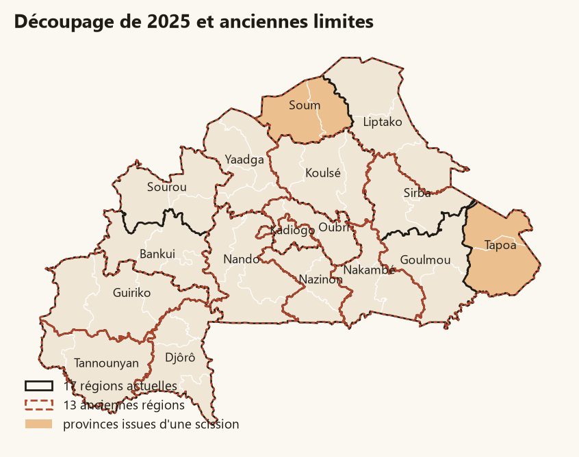
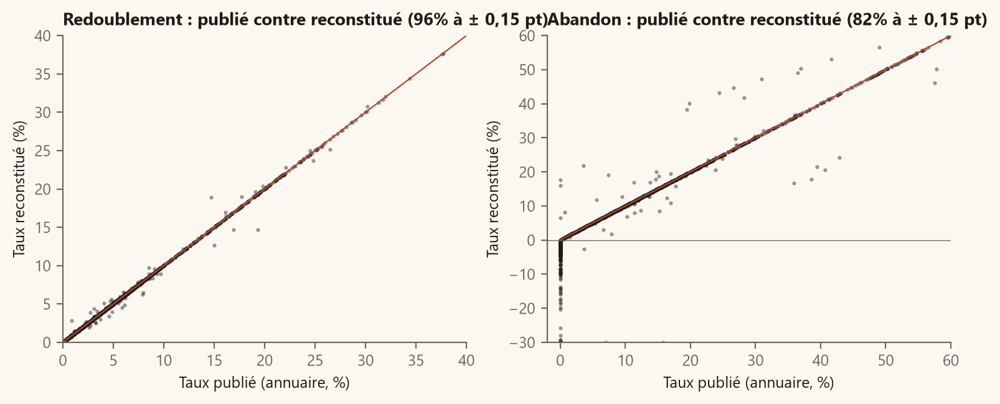
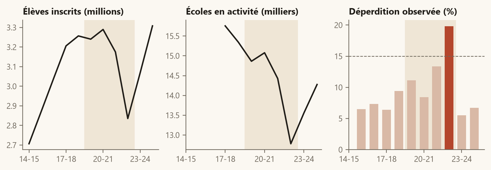
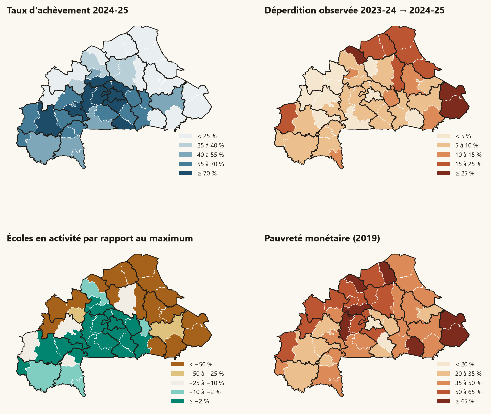
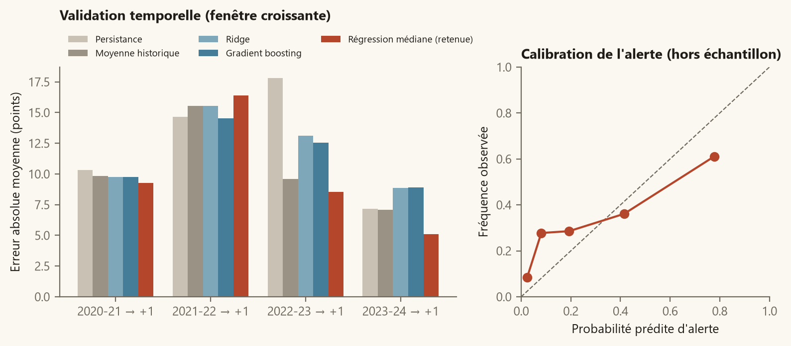
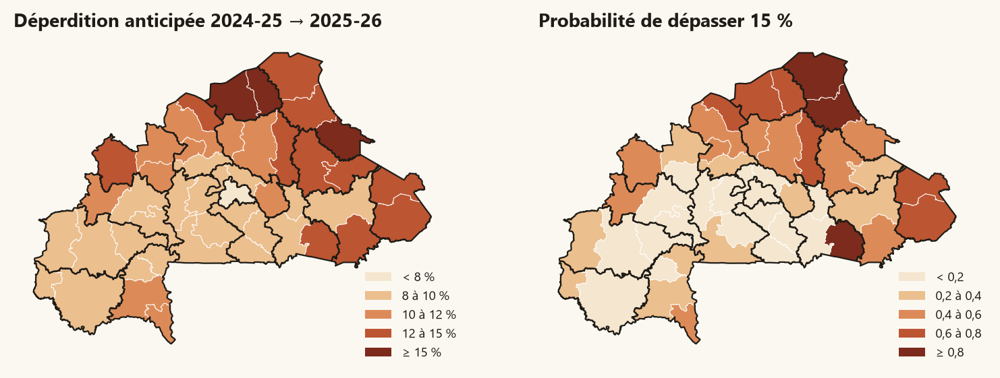
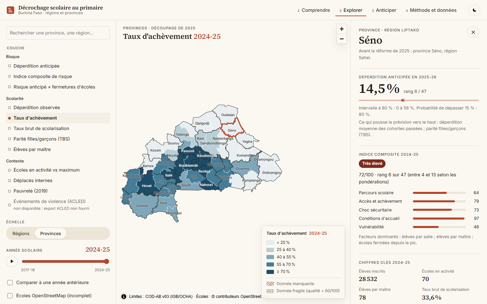

# Cartographier et anticiper le décrochage scolaire au primaire

Note technique · Data Challenge Burkina 2026 · Défi 1 « Décrochage scolaire » · version du 18 novembre 2026

## Résumé

Au Burkina Faso, l'école primaire a subi une rupture : entre 2021-22 et 2022-23, les effectifs ont baissé de 339 402 élèves, et le nombre d'écoles en activité est passé de 15 756 (2017-18) à 12 780 (2022-23). En 2024-25, le taux d'achèvement varie de 4,5 % (Tapoa) à 87,5 % (Kadiogo).

Nous proposons un outil d'aide à la décision qui répond à la question du défi : **quelles provinces risquent la plus forte déperdition scolaire l'an prochain, et pourquoi ?** Il comprend :

- une **base de données propre et traçable** : 253 785 valeurs extraites des huit annuaires du primaire (2017-18 à 2024-25), chacune avec son document, sa page, sa ligne et un indicateur de qualité. Les 19 valeurs de contrôle de l'annuaire 2023-24 sont retrouvées à l'identique ;
- une **harmonisation territoriale** vers le découpage de 2025 (17 régions, 47 provinces), utilisé pour toutes les cartes ;
- un **indice composite de risque** transparent (5 dimensions, 12 indicateurs) et un **modèle d'anticipation** validé dans le temps et dans l'espace, avec des intervalles d'incertitude ;
- une **application web** autonome (sans serveur ni tuiles externes), en quatre vues : Comprendre, Explorer, Anticiper, Méthode et données.

Pour 2025-26, **13 provinces sur 47** ont au moins une chance sur deux de dépasser 15 % de déperdition. Elles se concentrent dans les régions Yaadga (3), Koulsé (2), Liptako (2), Soum (2), Tapoa (2).

## 1. Données et périmètre

Le travail porte sur l'enseignement primaire (CP1 à CM2). Les sources viennent du Data Pack officiel. Aucune source externe n'a été intégrée : l'export ACLED (événements de violence), prévu comme source facultative, n'était pas disponible.

| Source | Contenu utilisé | Années | Niveau |
|---|---|---|---|
| Annuaires statistiques du primaire (DGESS, 8 éditions) | écoles, salles, maîtres, élèves par sexe et milieu, TBA, TBS, TNS, achèvement, taux de flux, effectifs et redoublants par classe | 2017-18 à 2024-25 (historiques depuis 2008-09) | 45 provinces, 13 régions |
| Limites COD-AB v03 (IGB/OCHA) | 351 communes avec ancien et nouveau P-code | 2025 | commune |
| Cartographie de la pauvreté (RGPH 2019, INSD) | incidence et profondeur de la pauvreté | 2018-2019 | province, commune |
| Déplacés internes (SP/CONASUR) | stock de PDI par commune | janv. 2019 à mars 2023 | commune |
| Écoles OpenStreetMap (HOT) | établissements géolocalisés (couche indicative) | nov. 2026 | point |

Les tableaux de bord, synthèses et dépliants de la DGESS ont servi de contrôle. Les rapports mensuels ESU, en majorité issus de reconnaissance optique (OCR) et non vérifiés, n'ont pas été utilisés : ce sont les annuaires qui mesurent les fermetures d'écoles, par l'évolution du nombre d'écoles en activité.

## 2. Extraction et contrôle de qualité

**Méthode.** Les CSV du pack restituent les tableaux PDF ligne à ligne. Chaque type de tableau a son parser. Les pages sont repérées par l'intitulé du tableau, car la numérotation change d'une édition à l'autre (« II.7 » en 2017-18, « I.8 » en 2024-25). Les noms de région, en titre de bloc, sont propagés vers les lignes de province. Les noms sont rapprochés d'un référentiel de P-codes qui gère les variantes d'écriture (Komondjari, Komandjoari, Komandjari…). La sortie est au format « tidy » : unité, année, indicateur, classe, sexe, milieu, statut, valeur, source, page, ligne, indicateur de qualité.

**Aucune correction manuelle silencieuse.** Les anomalies de la source sont traitées par des règles explicites, signalées par un indicateur de qualité et consignées dans le journal d'extraction (34 entrées) :

- 45 valeurs où deux nombres étaient fusionnés dans une même cellule. Elles sont séparées seulement quand la contrainte Total = Garçons + Filles donne une solution unique ;
- 336 valeurs d'historique dont le libellé d'année est abîmé (« 202122023 », année répétée). L'année est alors déduite de la position du bloc ;
- un bloc dupliqué écarté, et des lignes où une colonne urbain/rural est vide (seul le total est retenu) ;
- la Komandjari en 2022-23 : elle est absente du tableau des écoles alors que l'historique indique 0 élève. Elle est traitée comme « aucune école en activité » et signalée.

**Contrôles automatiques (pytest).**

| Contrôle | Résultat |
|---|---|
| Valeurs de contrôle de l'annuaire 2023-24 (national, Centre, Sahel, Est, Yagha, Boucle du Mouhoun) | 19 / 19 |
| Somme des provinces = total régional et national publiés | 98,3 % de 50 344 comparaisons |
| Taux = numérateur / dénominateur (TBA, TBS, TNS, achèvement) | 100,0 % de 5 664 |
| Promotion + redoublement + abandon = 100 (tableau des flux) | 100,0 % de 6 885 |
| Même année publiée dans plusieurs éditions : valeurs identiques | 98,5 % de 674 |

Les écarts de somme restants concernent surtout les blocs régionaux des historiques. Dans l'édition 2017-18, par exemple, trois années du Centre-Sud portent des valeurs identiques dans la source. Ils sont listés dans `outputs/quality/`, sans correction. Les totaux régionaux et nationaux utilisés par l'outil sont recalculés à partir des provinces.

## 3. Harmonisation territoriale

Les annuaires suivent l'ancien découpage (13 régions, 45 provinces), alors que les cartes doivent suivre celui de 2025 (17 régions, 47 provinces). Le passage repose sur les 351 communes, identiques dans les deux découpages : COD-AB associe à chacune son ancien et son nouveau P-code. Les polygones des quatre découpages sont obtenus par fusion des communes, après une simplification qui préserve les limites partagées. Les tests vérifient 13, 45, 17 et 47 entités valides, sans trou ni chevauchement.

<figure class="right"><figcaption>Découpage de 2025 (trait plein) et anciennes régions (tirets).</figcaption></figure>

- **43 provinces** correspondent chacune à une ancienne province (parfois renommée : Kossi devenue Kossin, Sanmatenga devenue Sandbondtenga, Oubritenga devenue Bassitenga).
- **Le Soum et la Tapoa** ont été scindés : en Djelgodji et Karo-Peli pour le premier, en Dyamongou et Gobnangou pour le second. Leurs effectifs sont répartis au prorata de la population 2019 des communes, tirée de la cartographie de la pauvreté. Les taux sont donc identiques dans les deux moitiés. Ces valeurs sont signalées dans l'outil et pénalisées dans le score de qualité. Pour la pauvreté, l'agrégation des communes donne une valeur exacte.
- **Chaque région actuelle est une union d'anciennes provinces entières** : ses totaux sont exacts. Une somme n'est calculée que si toutes les provinces membres sont renseignées : il n'y a aucun total partiel.

Contrôle : les totaux nationaux sont identiques quel que soit le découpage (test automatique).

## 4. Indicateurs

**Le taux d'abandon publié est résiduel.** Dans les annuaires, l'abandon est calculé par différence (100 − promotion − redoublement), puis borné à zéro. 246 taux publiés valent 0,0 ; pour 243 d'entre eux, le calcul de cohorte donne une déperdition nulle ou négative. Ce taux mesure mal le décrochage, surtout là où les effectifs varient fortement.

**Déperdition reconstituée (méthode de la cohorte reconstituée, UNESCO).** À partir des effectifs E et des redoublants R par classe c et année t :

promotion p(c,t) = [E(c+1,t+1) − R(c+1,t+1)] / E(c,t) · redoublement r(c,t) = R(c,t+1) / E(c,t) déperdition CP1-CM1 = 1 − Σc [E(c+1,t+1) − R(c+1,t+1) + R(c,t+1)] / Σc E(c,t)

Cette reconstitution retrouve les taux publiés à 0,15 point près dans 96 % des cas pour le redoublement, et dans 82 % des cas pour l'abandon. Les écarts se concentrent là où le taux publié est borné. Elle couvre aussi les années 2014-15 à 2016-17, absentes des annuaires étudiés. À l'échelle d'une province, il s'agit d'une **déperdition apparente** : elle inclut les abandons, les départs nets vers d'autres provinces et les élèves des écoles fermées. C'est la cible du modèle.

<figure><figcaption>Taux publiés (annuaires) contre taux reconstitués, provinces, 2016-17 à 2023-24. Les taux d'abandon publiés nuls correspondent à des déperditions reconstituées négatives.</figcaption></figure>

**Autres variables (par province et par année).** Taux brut de scolarisation et d'achèvement, par sexe, et indice de parité ; élèves par maître et par salle ; part rurale et part du privé ; survie jusqu'au CM2 ; redoublement ; pauvreté 2019 ; déplacés internes, en part de la population. Deux indicateurs servent de proxy du choc sécuritaire : la variation des écoles en activité et celle des élèves par rapport à leur maximum.

<figure><figcaption>Séries nationales : élèves, écoles en activité, déperdition observée (bande grise : années de crise 2019-2023).</figcaption></figure>

## 5. Diagnostic cartographique

<figure><figcaption>Provinces, découpage de 2025. Points : données fragiles (score de qualité inférieur à 60/100).</figcaption></figure>

En 2024-25, les régions où l'achèvement est le plus faible sont Tapoa (4,5 %), Soum (9,0 %), Sirba (10,4 %). Ce sont aussi celles qui ont perdu le plus d'écoles depuis 2017-18 (Soum −88 %, Tapoa −83 %, Liptako −78 %, Sirba −63 %, Sourou −55 %). À l'inverse, le taux brut de scolarisation dépasse 100 % dans les régions Kadiogo, Oubri, Nando, Nazinon. Ces taux montrent que les dénominateurs (projections du RGPH 2019) ne suivent pas les déplacements de population : nous utilisons de préférence des indicateurs fondés sur les seuls effectifs (déperdition, survie, évolution).

## 6. Indice composite de risque

L'indice résume la situation observée d'une province en 12 indicateurs regroupés en 5 dimensions : **parcours** (déperdition et redoublement de la cohorte précédente, survie), **accès** (achèvement, scolarisation), **choc sécuritaire** (écoles et élèves perdus depuis le maximum), **conditions d'accueil** (élèves par maître et par salle), **vulnérabilité** (pauvreté, écart filles-garçons, ruralité).

- **Normalisation :** chaque indicateur est converti en rang centile dans l'année (0 = situation la plus favorable, 100 = la plus défavorable). Ce choix résiste aux valeurs extrêmes des petites provinces.
- **Pondération :** chaque dimension pèse 20 %, et la moyenne ne porte que sur les dimensions renseignées.
- **Classes :** les quintiles de l'année, sur 5 niveaux de « très faible » à « très élevé ».
- **Robustesse :** la corrélation de rang avec une pondération par analyse en composantes principales est de 0,86, avec une pondération entropique de 0,98. Sur 2 000 jeux de poids tirés au hasard (loi de Dirichlet), le rang d'une province varie en moyenne dans une fourchette de 20 places. Chaque fiche affiche cette fourchette et les trois facteurs dominants.

## 7. Modèle d'anticipation

**Cible.** La déperdition apparente du passage de l'année t à t+1, plafonnée à [0 ; 60] %. **Variables.** Elles sont connues à la fin de l'année t, sans aucune information de t+1 (test automatique) : déperdition de la cohorte précédente et moyenne des cohortes passées, survie, redoublement, variation des effectifs, élèves et écoles perdus depuis le maximum, achèvement, scolarisation, parité, élèves par maître, part rurale et part du privé, pauvreté. Les déplacés internes sont exclus du modèle, faute de données après mars 2023. **Données.** 314 observations (45 anciennes provinces, cohortes 2017-18 à 2023-24). L'apprentissage se fait sur l'ancien découpage ; la prévision est calculée sur les 47 provinces actuelles avec les mêmes coefficients.

**Références et règle de sélection, fixées à l'avance.** Deux références naïves : la persistance (même déperdition que l'an passé) et la moyenne historique de la province. Candidats : régressions ridge, de Huber et médiane (régularisées), gradient boosting. Un modèle linéaire n'est éligible que s'il bat les deux références, en erreur absolue moyenne (MAE), en validation **temporelle** (fenêtre croissante : on apprend sur le passé et on teste l'année suivante, pour 4 années) **et** en validation **spatiale** (une région entière exclue). Parmi les éligibles, on retient la meilleure corrélation de rang. Les arbres ne sont retenus que s'ils font au moins 5 % mieux que les autres dans les deux validations.

| Modèle | MAE temporelle | Spearman temporel | MAE spatiale | Spearman spatial |
|---|---|---|---|---|
| Persistance (an passé) | 12,47 | 0,15 | 10,05 | 0,33 |
| Moyenne historique de la province | 10,52 | 0,35 | 10,58 | −0,42 |
| Régression ridge | 11,81 | 0,41 | 8,85 | 0,54 |
| Régression de Huber | 10,53 | 0,48 | 8,01 | 0,54 |
| Régression médiane **(retenu)** | 9,84 | 0,36 | 8,54 | 0,45 |
| Gradient boosting | 11,43 | 0,40 | 7,96 | 0,58 |

**Résultat.** Modèle retenu : régression médiane (linéaires éligibles : régression médiane). Sa MAE temporelle est inférieure de 7 % à celle de la meilleure référence. Le gradient boosting n'est pas retenu : en validation temporelle, sa MAE (11,43) ne fait pas 5 % mieux que la meilleure référence (10,52) et que le modèle retenu (9,84), bien qu'il soit le meilleur en validation spatiale (7,96 contre 10,05 pour la meilleure référence). Le classement des provinces reste difficile d'une année à l'autre (Spearman de 0,36), car la crise a déplacé les zones de déperdition. **L'alerte** (déperdition ≥ 15 %) est estimée par une régression logistique distincte : AUC de 0,71 en validation temporelle et 0,82 en validation spatiale, contre 0,54 pour la persistance.

<figure><figcaption>Gauche : erreur absolue moyenne par année testée. Droite : calibration des probabilités d'alerte (hors échantillon).</figcaption></figure>

**Incertitude.** Les intervalles viennent d'une prédiction conforme normalisée par la volatilité passée de chaque province. Les quantiles sont estimés sur les résidus hors échantillon. Couverture réelle de l'intervalle à 80 %, mesurée sur une année non utilisée pour le calibrer : 64 % (2021-22), 100 % (2022-23), 98 % (2023-24). Les provinces dont la déperdition a le plus varié ont les intervalles les plus larges (Yagha, Karo-Peli, Djelgodji) : leur prévision se lit comme un signal d'alerte, pas comme une valeur précise.

## 8. Résultats : provinces à surveiller en 2025-26

<figure><figcaption>Prévision pour le passage de 2024-25 à 2025-26, découpage de 2025.</figcaption></figure>

| # | Province | Région | Prévision | Intervalle à 80 % | P(alerte) | Facteurs dominants (indice 2024-25) |
|---|---|---|---|---|---|---|
| 1 | Yagha | Liptako | 17,8 % | 0 à 60 % | 46 % | faible achèvement ; écoles fermées depuis le pic ; élèves par maître |
| 2 | Karo-Peli | Soum | 15,3 % | 0 à 60 % | 77 % | perte d'élèves depuis le pic ; écoles fermées depuis le pic ; faible scolarisation |
| 3 | Djelgodji | Soum | 15,3 % | 0 à 60 % | 71 % | écoles fermées depuis le pic ; perte d'élèves depuis le pic ; faible scolarisation |
| 4 | Komandjari | Sirba | 15,0 % | 0 à 60 % | 22 % | écoles fermées depuis le pic ; faible achèvement ; faible scolarisation |
| 5 | Oudalan | Liptako | 14,6 % | 6 à 23 % | 83 % | élèves par salle ; élèves par maître ; écoles fermées depuis le pic |
| 6 | Séno | Liptako | 14,5 % | 0 à 58 % | 80 % | élèves par salle ; élèves par maître ; écoles fermées depuis le pic |
| 7 | Kompienga | Goulmou | 14,2 % | 0 à 60 % | 46 % | élèves par salle ; élèves par maître ; faible scolarisation |
| 8 | Dyamongou | Tapoa | 13,9 % | 1 à 26 % | 71 % | perte d'élèves depuis le pic ; faible scolarisation ; faible achèvement |
| 9 | Gobnangou | Tapoa | 13,9 % | 1 à 26 % | 70 % | perte d'élèves depuis le pic ; faible scolarisation ; faible achèvement |
| 10 | Loroum | Yaadga | 13,9 % | 0 à 50 % | 70 % | élèves par salle ; élèves par maître ; faible achèvement |
| 11 | Namentenga | Koulsé | 13,0 % | 0 à 52 % | 70 % | faible scolarisation ; faible achèvement ; écoles fermées depuis le pic |
| 12 | Koulpélogo | Nakambé | 13,0 % | 0 à 56 % | 92 % | pauvreté ; écart filles-garçons ; ruralité |

## 9. L'application web

<figure><figcaption>Vue Explorer : carte des provinces, classement synchronisé, fiche de la province.</figcaption></figure>

L'application est une page statique (Vite, React, TypeScript, MapLibre GL), déployable gratuitement sur GitHub Pages, Netlify ou Vercel. La carte est construite sur nos propres polygones, sans tuiles ni polices externes : elle fonctionne avec une connexion faible. Les couches lourdes (écoles OSM, modèle, journal de qualité) sont chargées à la demande.

- **Comprendre** : chiffres d'accroche, trois constats et mode d'emploi, tous calculés à partir des données.
- **Explorer** : carte plein écran à deux échelles (régions et provinces), 11 couches, dont une carte bivariée risque × fermetures. Curseur temporel avec lecture animée, comparaison avant/après, hachures pour les données manquantes et points pour les données fragiles. Classement triable et filtrable, synchronisé avec la carte, et recherche. La fiche province présente les indicateurs clés, les mini-graphiques, l'écart filles-garçons, le rang, la prévision avec son intervalle, les facteurs, la qualité et les sources. On peut comparer deux provinces. Exports : image PNG, CSV, fiche imprimable en PDF. Le lien conserve la vue partagée.
- **Anticiper** : classement 2025-26, comparaison du modèle aux références, incertitude, importance des variables et pistes d'action.
- **Méthode et données** : sources et licences, définitions, table de correspondance des découpages, journal de qualité, limites.

Accessibilité : contrastes AA, navigation au clavier, rôles ARIA. Une alternative textuelle décrit la carte et le tableau de classement en donne toutes les valeurs. Le mode sombre et la préférence « mouvement réduit » sont respectés. Toutes les valeurs affichées proviennent des fichiers exportés par le pipeline.

## 10. Recommandations par type de province

Les pistes sont déduites des dimensions dominantes de l'indice (score ≥ 60/100) et de l'écart filles-garçons (indice de parité inférieur à 0,95). Elles concernent les provinces prioritaires : indice élevé ou probabilité d'alerte d'au moins 50 %.

| Type | Provinces prioritaires concernées | Pistes d'action |
|---|---|---|
| Éducation en situation d'urgence | Bam, Banwa, Djelgodji, Dyamongou, Gnagna, Gobnangou, Karo-Peli, Komandjari, Kompienga, Loroum, Namentenga, Nayala, Oudalan, Sourou, Yagha | espaces temporaires d'apprentissage et réouverture progressive des écoles fermées ; redéploiement et prime des enseignants vers les écoles d'accueil ; inscription et suivi nominatif des élèves déplacés internes ; cantines et soutien psychosocial dans les écoles d'accueil |
| Accès et maintien | Djelgodji, Dyamongou, Gnagna, Gobnangou, Karo-Peli, Komandjari, Kossin, Koulpélogo, Namentenga, Sourou, Séno, Yagha | campagnes d'inscription au CP1 et recherche des enfants non scolarisés ; passerelles de l'éducation non formelle vers le primaire ; écoles satellites pour rapprocher l'offre des villages |
| Appui à la scolarisation des filles | Banwa, Djelgodji, Karo-Peli, Kompienga, Kossin, Koulpélogo, Oudalan, Sourou, Séno, Yagha | bourses et kits pour les filles ; latrines séparées et points d'eau ; mentorat et lutte contre le mariage précoce |
| Capacité d'accueil | Bam, Banwa, Kompienga, Kossin, Loroum, Nayala, Oudalan, Sandbondtenga, Séno, Yatenga | affectation prioritaire de nouveaux enseignants ; construction ou réhabilitation de salles de classe (remplacement des paillotes) ; équipement en tables-bancs et manuels |
| Parcours et réussite | Sandbondtenga, Yatenga, Zondoma | détection précoce des absences répétées et alerte au niveau de l'école ; remédiation ciblée au CE1 et au CM1, classes où la déperdition est la plus forte ; suivi nominatif des élèves non réinscrits à la rentrée |
| Vulnérabilité des familles | Koulpélogo | cantines scolaires et kits scolaires ; sensibilisation contre le travail des enfants (orpaillage) et le mariage précoce ; articulation avec les transferts sociaux |

Ces pistes servent à orienter le dialogue avec les directions régionales et provinciales : elles doivent être confrontées au terrain, en particulier aux données des rapports ESU vérifiées par le ST-ESU.

## 11. Limites

- **Déperdition apparente :** à l'échelle d'une province, abandons, migrations et fermetures d'écoles ne se distinguent pas.
- **Séries courtes et rupture :** sept cohortes avec une cible connue, dont plusieurs années de crise. Une nouvelle vague de fermetures ne peut pas être anticipée par les données passées.
- **Dénominateurs :** le RGPH 2019, projeté, n'intègre pas les déplacements depuis 2019, d'où des taux supérieurs à 100 % ou anormalement bas.
- **Provinces scindées en 2025 :** valeurs réparties au prorata de la population 2019.
- **Facteur sécuritaire indirect :** ni ACLED, ni déplacés internes après mars 2023 ; le choc est mesuré par les écoles et les élèves perdus.
- **Pauvreté figée en 2019 ;** couche OpenStreetMap incomplète, présentée à titre indicatif.

## 12. Reproductibilité

Une seule commande régénère toutes les sorties : `make all`, ou `python -m pipeline all` sans make. Le pipeline lit le Data Pack en lecture seule, fixe la graine aléatoire et écrit tout dans `outputs/` et `web/public/data/`. Il comprend 42 tests pytest (valeurs de contrôle, sommes, topologie, absence de fuite d'information) et 21 tests de rendu de l'application. Un contrôle automatisé dans un navigateur vérifie l'absence d'erreur console sur 11 vues. Le code, les décisions (`DECISIONS.md`), l'inventaire des données (`DATA_INVENTORY.md`) et le dictionnaire de données (`docs/dictionnaire_donnees.md`) sont versionnés.

Sources : MEBAPLN/DGESS, annuaires statistiques de l'enseignement primaire 2017-18 à 2024-25 (via CNS) ; INSD, RGPH 2019, volume 3 « Mesure et cartographie de la pauvreté » ; SP/CONASUR, situation des personnes déplacées internes (via HDX) ; IGB/OCHA, limites administratives COD-AB v03 (via HDX, CC BY-IGO) ; © contributeurs OpenStreetMap, établissements d'enseignement (HOT, ODbL 1.0).

